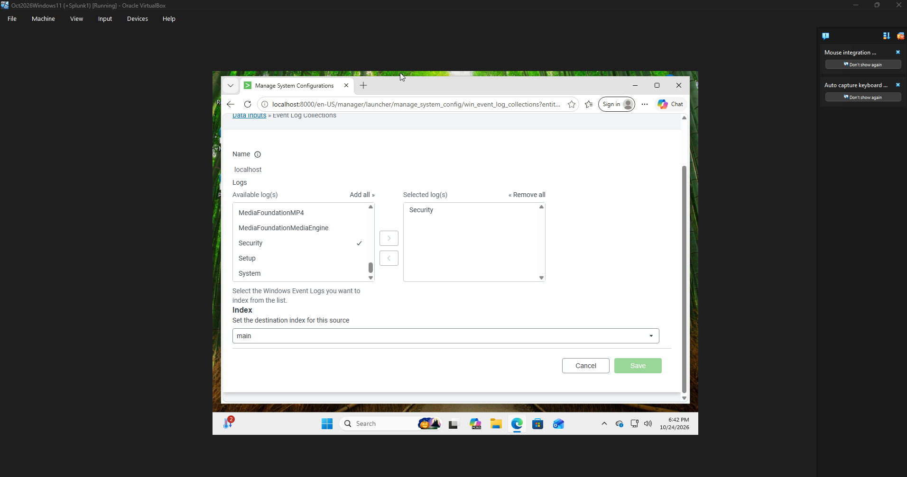
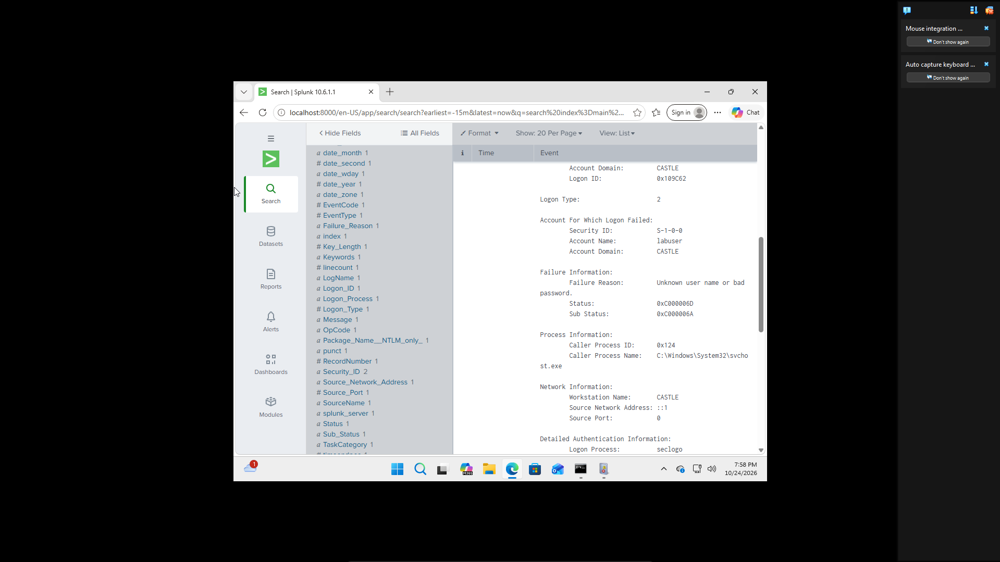
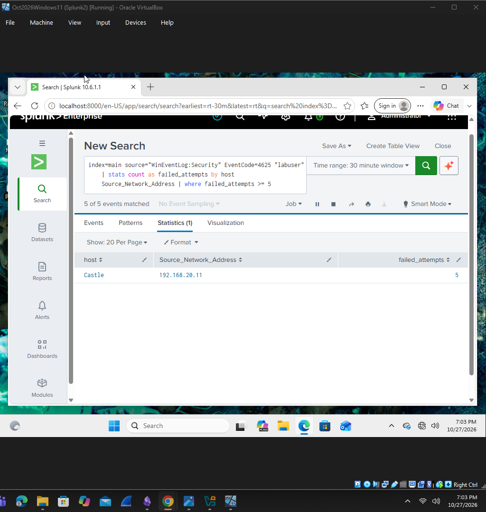
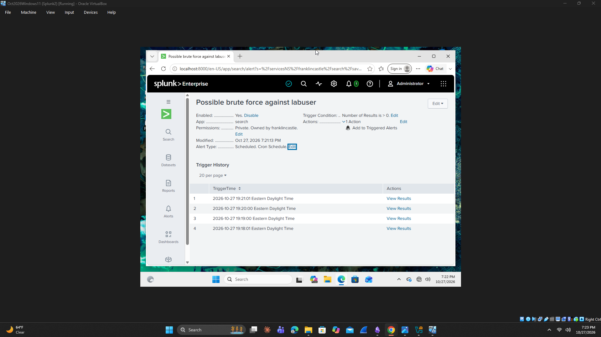
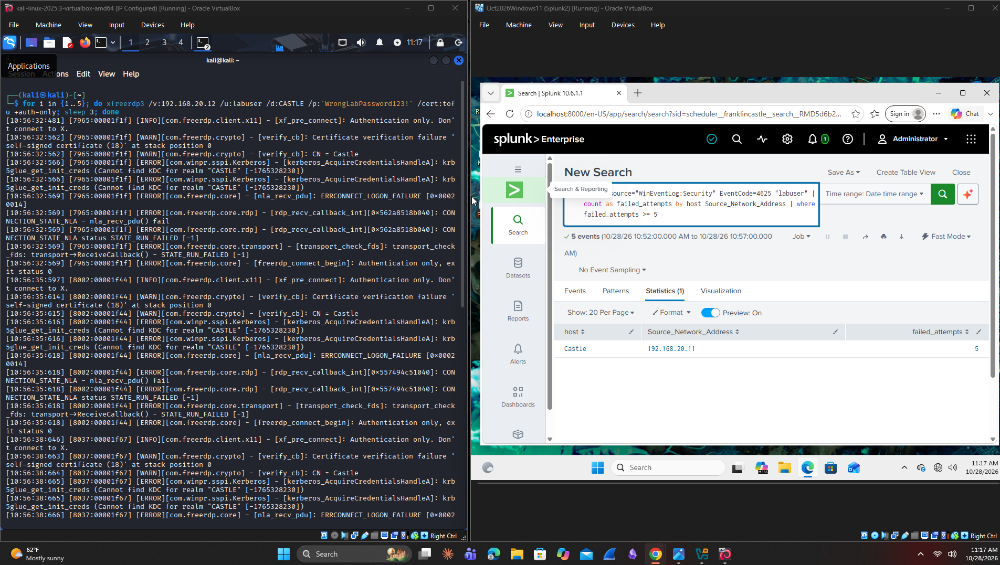

# Splunk Brute-Force Detection Lab

## Overview
Built a VirtualBox lab to detect repeated failed Windows logins using Splunk. Generated controlled RDP authentication failures from Kali Linux, investigated Windows Security logs, and validated a scheduled alert.

## Environment
- VirtualBox
- Windows 11 with Splunk Enterprise
- Kali Linux with FreeRDP
- Windows Security logs: Event ID 4625
- Test account: labuser

## Lab Process

### 1. Collect Windows Security Logs
Configured Splunk to collect the Windows Security event log into the main index.



### 2. Investigate Failed Logins
Reviewed failed authentication events and examined the account name, failure reason, logon type, and source address.

This screenshot shows an earlier local login test with the loopback address ::1. The later remote tests used Kali Linux.



### 3. Create the Detection Query
Used the following SPL query to identify five or more failed logins associated with labuser, grouped by destination host and source IP within the selected search period.

```spl
index=main source="WinEventLog:Security" EventCode=4625 "labuser"
| stats count as failed_attempts by host Source_Network_Address
| where failed_attempts >= 5
```

The search returned five failed attempts from 192.168.20.11 against the Windows host Castle.



### 4. Validate with Controlled Authentication Attempts
Used FreeRDP from Kali Linux to make repeated authentication attempts against my Windows VM using an intentionally incorrect test password.

Splunk's scheduled search results showed five matching failed-login events from the Kali source IP.



### 5. Validate the Scheduled Alert
Configured a scheduled alert to trigger when the detection search returned more than zero results. Used the Add to Triggered Alerts action and verified entries in the trigger history.



## Results
- Collected and searched Windows Security logs.
- Identified failed authentication activity involving the test account.
- Detected five failed logins from the Kali source IP.
- Verified that the scheduled alert triggered.

## Limitations and Improvements
- Repeated failed logins indicate possible brute force; legitimate password mistakes can also trigger the rule.
- This query searches for the text "labuser." A broader rule should use the relevant account field and support multiple accounts.
- The threshold applies to the selected search period, so the alert's time window affects detection.
- Overlapping scheduled searches can alert repeatedly on the same events. Alert throttling could reduce duplicate notifications.
- Future testing could compare below-threshold activity with activity that meets the threshold.

## Skills Demonstrated
Splunk SPL, Windows event log analysis, authentication monitoring, scheduled alert configuration, and detection validation.

## Scope
All authentication tests were performed against virtual machines I own in my personal lab.
